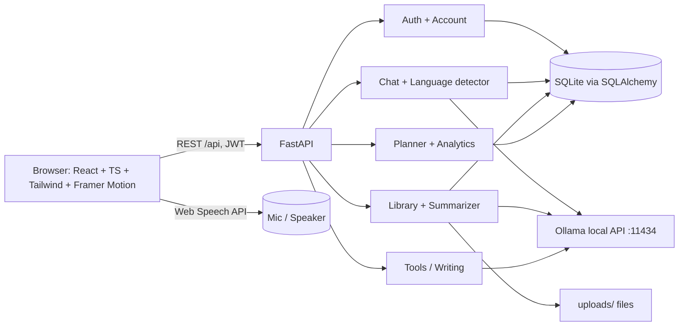
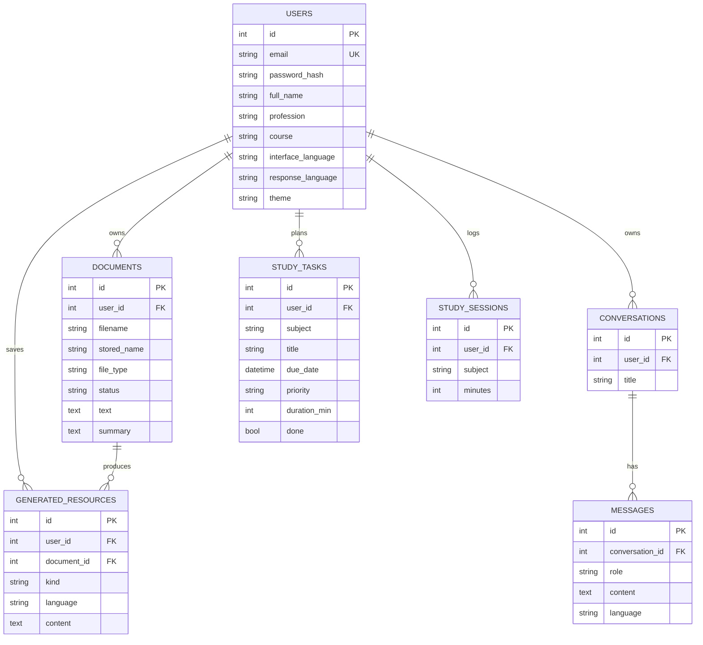
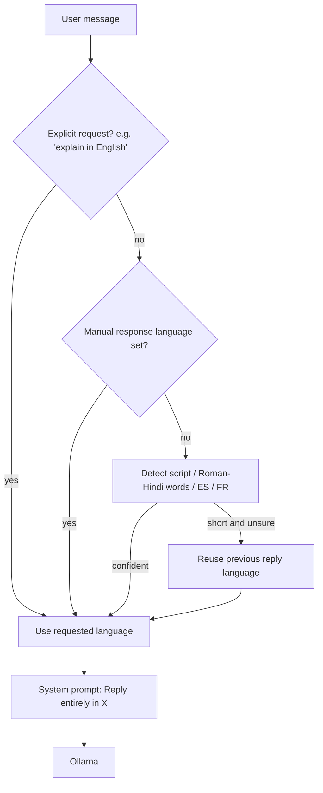
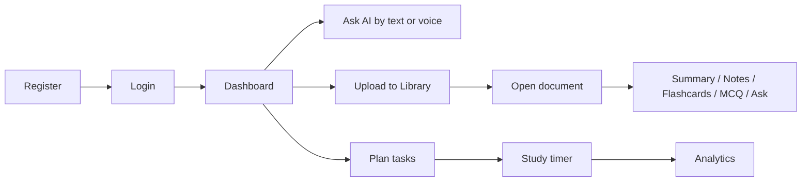

# EduNexus - Architecture, ER diagram, workflow

## 1. System architecture

Layers: `api/` (routes + validation), `services/` (language, ollama, llm, documents), `models/` (ORM), `core/` (config, security), `database/` (session).

## 2. ER diagram

User preferences (interface language, response language, theme) are columns on `users`.

## 3. Automatic response-language flow

## 4. User workflow

## 5. Future scope (extension points)
- OCR: `services/documents.extract()` (documents with status `needs_ocr`).
- RAG with citations: replace `documents.top_chunks()` with embeddings; `/ask` already returns source part numbers.
- Other AI providers: `services/ollama.chat()` is the single model entry point.
- Cloud sync / classrooms: all rows are keyed by `user_id`.
